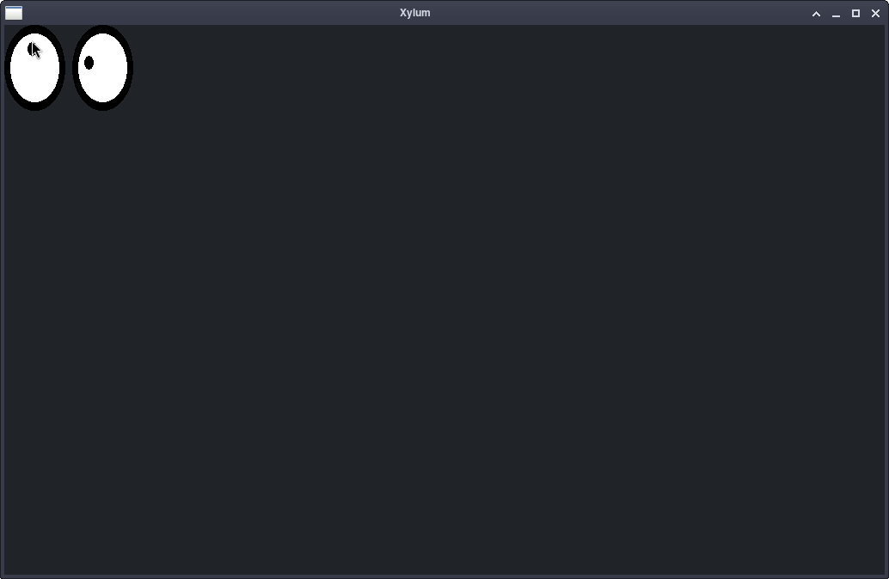
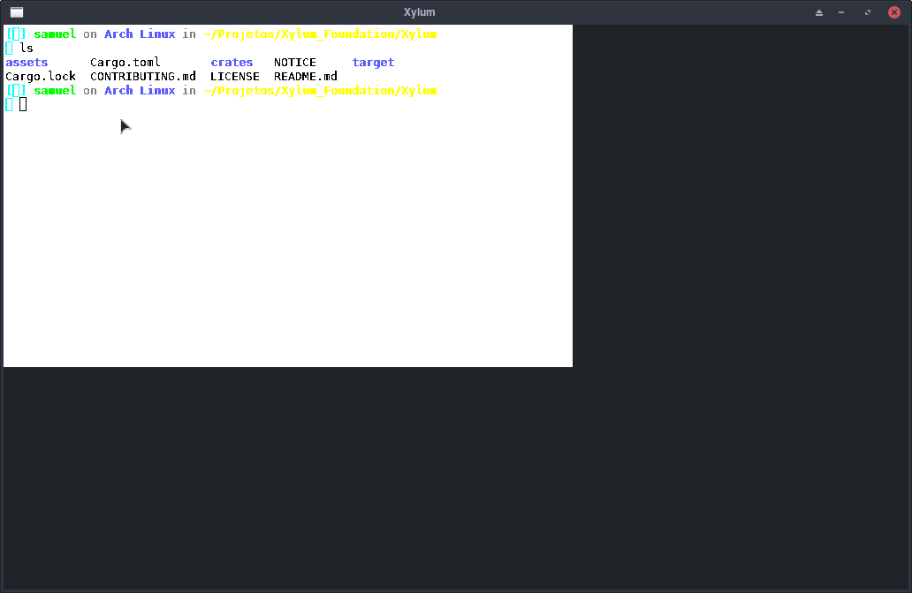
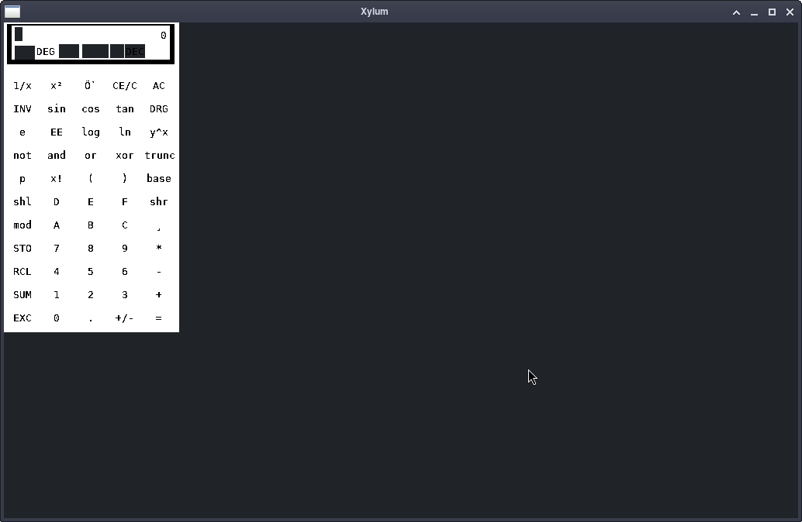

<div align="center">
  
  
  # Xylum
  
  **A modern X11 display server, written from scratch in Rust.**
  
  [](https://www.gnu.org/licenses/gpl-3.0)
  [](https://www.rust-lang.org/)
  []()
</div>

---

## About

**Xylum** is an X11 display server built from the ground up in **Rust**. It aims to bring the classic X11 client-server architecture into the modern era, taking advantage of Rust's memory safety and modern graphics APIs.

Unlike traditional X.Org implementations, Xylum is designed to be:
- **Safe:** Written in Rust, eliminating entire classes of memory corruption bugs.
- **Modular:** A clean, crate-based workspace.
- **Modern:** Built to eventually leverage Vulkan for zero-copy hardware acceleration.

## Current Status

Xylum is in **early development**, but the core X11 protocol is already functional. It can successfully run real, unmodified X11 applications.

### What works today:
- [X] **Handshake & Auth:** MIT-MAGIC-COOKIE-1 authentication.
- [X] **Core Protocol:** Window management (Create, Map, Unmap, Configure), Atoms, Properties.
- [X] **Graphics:** GCs (Graphics Contexts), Lines, Rectangles, Arcs, Polygons, Text rendering.
- [X] **Fonts:** Built-in 8x16 bitmap font with fallback for legacy font requests.
- [X] **Colors:** 256-color palette and named color lookup (`RGB` database).
- [X] **Input:** Keyboard routing and mouse tracking.
- [X] **Software Rendering:** Direct framebuffer presentation via `softbuffer`.

## Screenshots

Here is Xylum running classic X11 applications natively:

<div align="center">
  
  
  
</div>

## Building and Running

### Prerequisites
- Rust (Edition 2024)
- A Linux environment (X11 libraries not required to compile, but needed for some client apps)
- `xauth` (to generate authentication cookies)

### 1. Clone the repository
```bash
git clone https://github.com/Xylum-Foundation/Xylum.git
cd Xylum
```

### 2. Build the workspace
```bash
cargo build --release
```

### 3. Add a security cookie
Xylum uses MIT-MAGIC-COOKIE-1 for authentication. Generate one for the display we'll use (e.g., `:2`):
```bash
xauth add :2 . $(mcookie)
```

### 4. Run Xylum
```bash
cargo run --release -p xylum-server
```
*By default, Xylum listens on `/tmp/.X11-unix/X2` (Display `:2`).*

### 5. Run an X11 App
In another terminal, open any classic X11 app:
```bash
DISPLAY=:2 xeyes
DISPLAY=:2 xterm
DISPLAY=:2 xcalc
```

## Roadmap

We are currently working towards a fully functional, accelerated X11 server. Next up:

- [ ] **MIT-SHM (Shared Memory):** Huge performance boost for apps sending large buffers (like `xterm`).
- [ ] **Window Management Support:** Implement `ReparentWindow` and `SubstructureRedirect` so real Window Managers (like i3 or openbox) can run.
- [ ] **Vulkan Backend:** Replace `softbuffer` with a Vulkan-based presenter.
- [ ] **XRender Extension:** For anti-aliased text and modern UI elements.

## Contributing

Xylum is a massive undertaking and we welcome contributions! Whether it's fixing bugs, implementing missing X11 requests, or improving documentation.

1. Fork the repository.
2. Create your feature branch (`git checkout -b feature/AmazingFeature`).
3. Commit your changes (`git commit -m 'feat: Add some AmazingFeature'`).
4. Push to the branch (`git push origin feature/AmazingFeature`).
5. Open a Pull Request.

Please read our [CONTRIBUTING.md](./CONTRIBUTING.md) for detailed guidelines on coding style, commit messages, and development setup.

## License

Xylum is free software: you can redistribute it and/or modify it under the terms of the **GNU General Public License, version 3 or (at your option) any later version** (`GPL-3.0-or-later`).

See [LICENSE](./LICENSE) for the full text.

---
<div align="center">
  <i>Built with rust by the Xylum Foundation.</i>
</div>